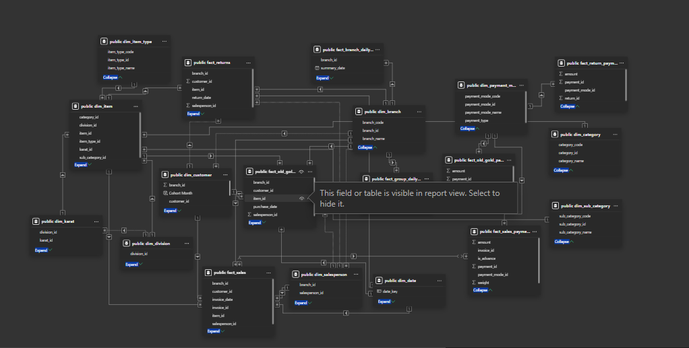
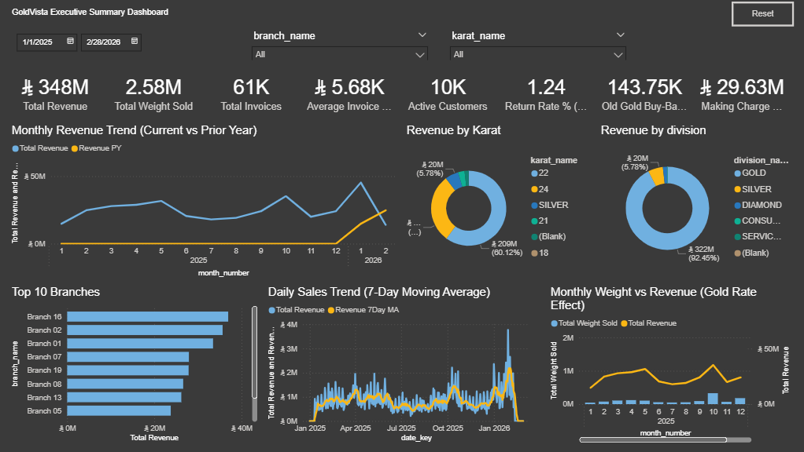

# GoldVista Retail Analytics

End-to-end analysis of a fictional Saudi jewellery retailer, built for the Upcode Software Labs Data Analyst / Power BI Developer capstone. It uses PostgreSQL, Excel and Power BI to answer eight business questions.

- **Data:** 19 tables in PostgreSQL (`goldvista_db`), January 2025 to February 2026
- **Currency:** Saudi Riyal (SAR)
- **Scale:** 61,361 invoices, 45,363 customers, SAR 348.3M revenue (sales only, returns excluded)

## Key findings

| Challenge | Finding |
|---|---|
| C-01 Branch performance | Branches 16, 02 and 01 bring in about 30% of revenue; the top 12 branches about 93% |
| C-02 Customer retention | 84% of customers bought once; the 16% who return produce 43% of revenue; buy-back customers repeat at 45.7% vs 14.6% |
| C-03 Returns | 1,071 returns, 1.75% of invoices; Branch 06 highest rate (3.9%) |
| C-04 Payment modes | Cash 64%, card 32%, transfer 5% of money collected |
| C-05 Old-gold buy-back | Buy-back customers spend about 12% more per invoice; payout about SAR 37.8M |
| C-06 Salesperson effectiveness | Top 10 of 125 salespeople produce about 33% of revenue; two IDs are whole branches |
| C-07 Daily and seasonal patterns | Friday carries 25% of invoices; peak months Jan 2026, Oct 2025, May 2025 |
| C-08 Karat and product mix | 22K and 24K make up about 90% of revenue; five item types make up 75% |

## Repository structure

```
goldvista-retail-analytics/
├── README.md
├── sql/
│   ├── exploration/        # table and data profiling queries
│   ├── business_queries/   # the business queries, each with a header comment
│   └── views/              # 8 reusable views
├── excel/                  # 4 workbooks: branch revenue, customer report, operations, product analysis
├── powerbi/                # goldvista.pbix and a PDF export of the dashboard
├── docs/                   # project report, presentation, data dictionary, DAX measures
└── images/                 # data model and dashboard page screenshots
```

Each SQL folder also contains a `query_outputs` folder with the saved results.

## Power BI dashboard

Six pages built on a star schema, with 39 DAX measures, drill-through, bookmarks, tooltip pages and a custom theme. Open `powerbi/goldvista.pbix` in Power BI Desktop, or view `powerbi/goldvista.pdf`. All measures are listed in `docs/dax_measures.xlsx`.




## How to reproduce

1. Create a PostgreSQL database named `goldvista_db` and load the 19 source tables.
2. Run the files in `sql/views/` to create the views, then the files in `sql/business_queries/`.
3. Open `powerbi/goldvista.pbix` and update the data source to point at your database.

## Documents

- `docs/GoldVista_Project_Report.pdf`: 12-page report covering all eight challenges
- `docs/GoldVista_Presentation.pptx`: 12-slide deck
- `docs/data_dictionary.xlsx`: all tables and columns, relationships and data quirks
- `docs/dax_measures.xlsx`: all 39 DAX measures with plain-English meanings

## Data notes

- Revenue uses sales lines only (`is_return = FALSE`).
- February 2026 is an incomplete month.
- Branches 04, 06, 15 and 17 only have data for January to March 2025; Branches 11 and 14 have no sales.
- Discounts are almost absent in the data (58 of about 90,800 sale lines).
- Some salesperson IDs equal whole branches, and some customer records are generic walk-in IDs.

## Author

Aliya Arakkal Ameer